  

 

 

I'm a CS student who likes building things from scratch, from neural nets to compilers to a tiny container engine.

- Studying Computer Science at NITC
- Into deep learning, RAG and LLM agents
- Also into compilers, operating systems and low-level C
- Currently learning neural networks and getting better at all of it

 

 

 

 

 

 

